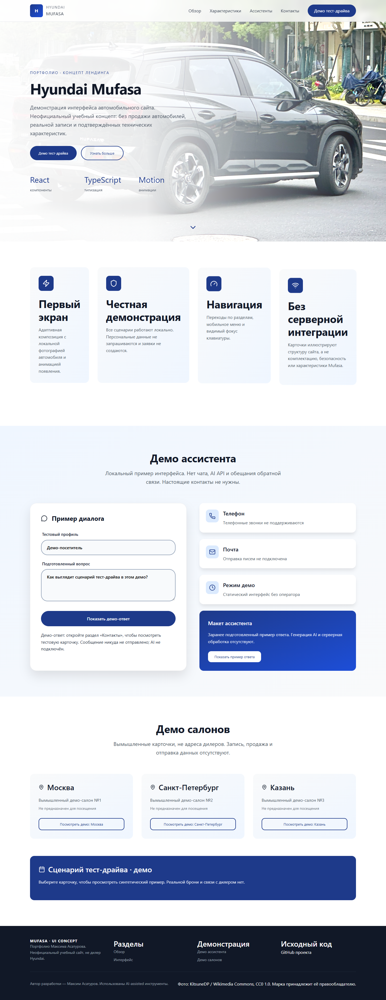
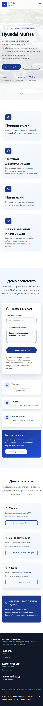

# Mufasa — концепт автомобильного лендинга

Неофициальный русскоязычный сайт на React и TypeScript: адаптивный первый экран, навигация по разделам, анимации и локальные демонстрации ассистента и тест-драйва. Проект показывает разработку интерфейса; это не сайт производителя или действующего дилера.

[Публичное демо](https://vortexfront.github.io/hyundai-/) · [Изображения и лицензии](ATTRIBUTIONS.md)

> Изменения из ветки `fix/public-portfolio-polish` доступны в исходниках PR. GitHub Pages публикует отдельную ветку `gh-pages`; обновлённый интерфейс появится после одобрения PR и отдельного развёртывания владельцем.




## Реализовано

- Адаптивная сетка, меню для мобильного экрана, рабочие якоря, Escape для меню и видимый фокус клавиатуры.
- Анимации появления и переходов на Motion; учтено предпочтение уменьшенного движения в CSS.
- Демо ассистента: подготовленный вопрос и локальный ответ без отправки сообщения.
- Демо тест-драйва: выбор вымышленного салона и просмотр синтетической карточки; состояние проверки сбрасывается при новом выборе.
- Фото Hyundai Mufasa хранится локально, имеет подтверждённую лицензию CC0 и атрибуцию. Стандартные значки Vite/React заменены собственным favicon.

## Стек и запуск

React 19, TypeScript 5, Vite 7, CSS Modules, Motion, Lucide React. Для разработки рекомендуется Node.js 24 LTS и npm.

```sh
npm ci
npm run dev
```

Разработка: `http://localhost:5173/hyundai-/`. Production-предпросмотр сохраняет путь GitHub Pages `/hyundai-/`:

```sh
npm run build
npm run preview
```

## Проверки

```sh
npm run lint
npm run typecheck
npm run build
npx playwright install chromium --only-shell
npm run test:e2e
npm audit
```

Два браузерных сценария для 1440 и 390 px проверяют загрузку фото, отсутствие горизонтального переполнения, клавиатурную навигацию и мобильное меню, оба демо-сценария, сброс состояния, отсутствие редактируемых контактных полей, запросов к сторонним адресам, POST-запросов, ложных подтверждений и контактов в консоли. CI выполняет проверки без прав на публикацию и без развёртывания Pages. Для локальной проверки установленным Chromium можно задать `PW_CHROMIUM_EXECUTABLE`.

Выполнено 2026-11-06: установка, lint, typecheck, build и оба сценария Chrome — успешно. Скриншоты сделаны из production-сборки и просмотрены визуально. Ручной тест через интерфейс браузера **не выполнен**: доступ к локальному браузеру отключён в настройках Work. Автоматические проверки не объявляются ручными.

Обновлён lockfile в пределах совместимых версий. Для устранения advisory транзитивного minimatch добавлен ограниченный override `@typescript-eslint/typescript-estree → minimatch 11.0.4`; после обновления проверены lint, сборка и тесты. `npm audit` на дату проверки — 0 известных уязвимостей; это не гарантия отсутствия новых advisory.

## Ограничения

Нет backend, AI API, оператора чата, бронирования, продажи автомобилей или отправки почты. Все поля демонстраций доступны только для чтения; настоящие контакты вводить не нужно. Состояние хранится только в памяти страницы. Салоны вымышлены и не предназначены для посещения. Технические характеристики и комплектации автомобиля не подтверждались: прежние числа 280 л.с., 6.8 с и AWD удалены, карточки описывают интерфейс. Сайт не является источником сведений для покупки автомобиля. Товарные знаки принадлежат их правообладателям.

## Авторство

Проект целиком создан **Максимом Асатуровым**. Автор отвечает за реализацию, технические решения, отладку и проверку результата; в работе использовались AI-assisted инструменты. Сторонние библиотеки и фотография имеют собственных авторов и лицензии, указанные отдельно. Демонстрационные автомобильные и сервисные сценарии не являются реальными бизнес-показателями автора.
